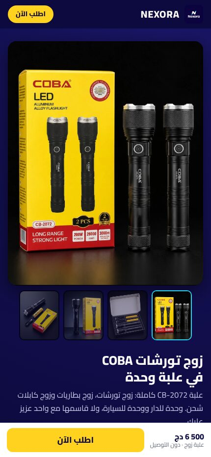

# Nexora: product landing page, order form and admin dashboard

**Live:** [jweebae.github.io/nexora-order-page](https://jweebae.github.io/nexora-order-page/)

A mobile-first sales funnel for Nexora, an Algerian e-commerce brand selling COBA LED torches with cash on delivery. I created the brand's visual identity, social media pages and ads, and built this page and its dashboard.

## Features

**Order page** (`index.html`)
- Arabic product page with image gallery and a sticky "order now" bar
- Order form with wilaya → commune selection for all of Algeria (`communes.js`)
- Orders sent to a Supabase Edge Function, which validates them server-side
- Meta Pixel and TikTok Pixel events for ad tracking

**Admin dashboard** (`admin.html`)
- Supabase Auth login, with admin rights checked in the database
- Order list with status updates and a per-order change history
- Revenue stats and CSV export
- Admin management (add and remove admins) with an activity log
- Interface in Arabic, French and English

## Tech stack

HTML, CSS, vanilla JavaScript · Supabase (Postgres, Auth, Row Level Security, Edge Functions) · GitHub Pages

---

Designed and built by **Adem Djouiba** ([DexLab Studio](https://dexlab.store)) · [LinkedIn](https://www.linkedin.com/in/ademdjouiba/)
